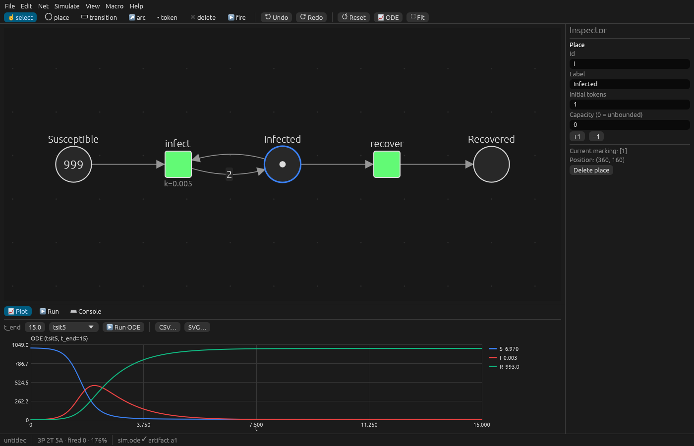
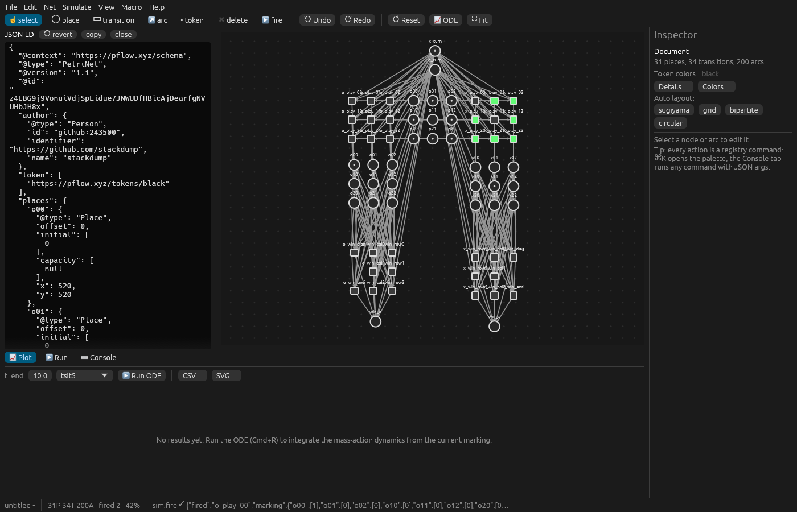
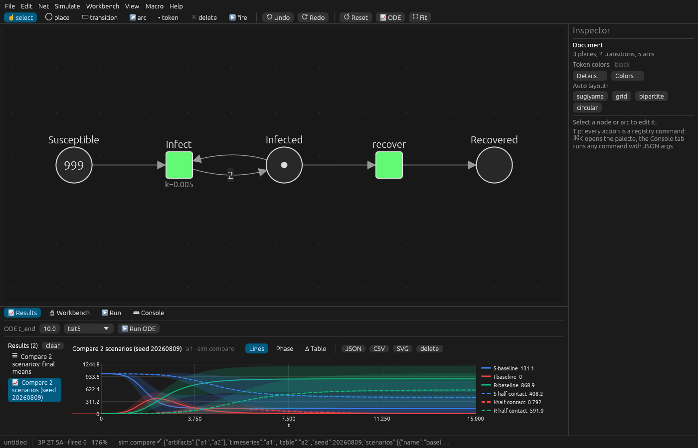
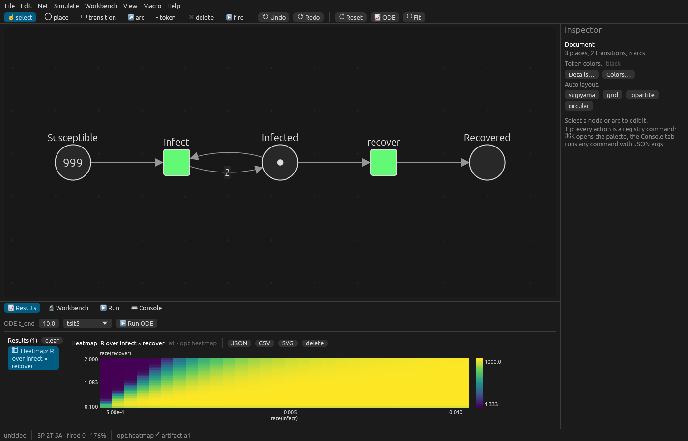
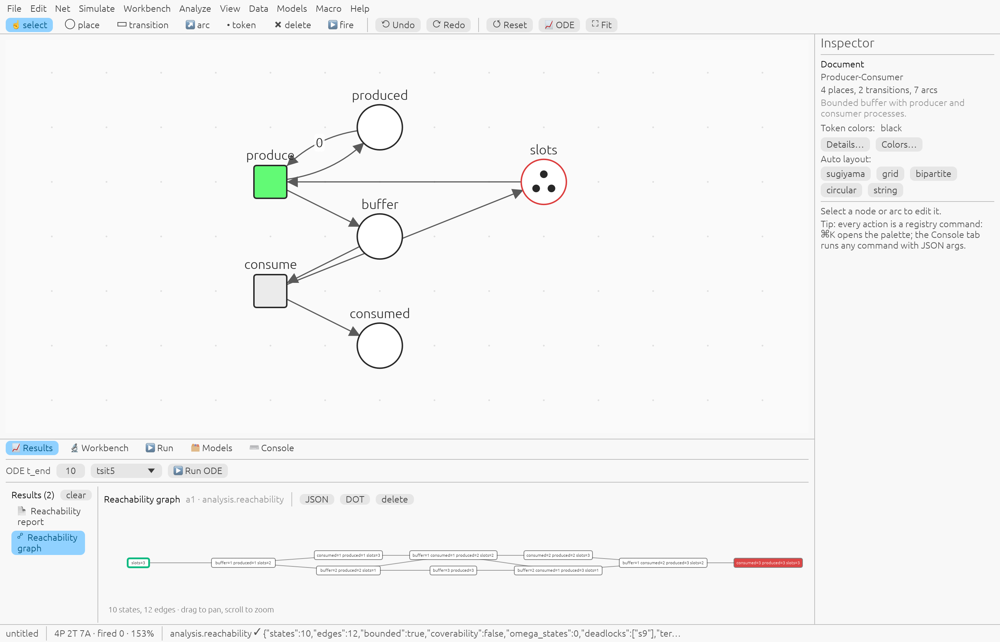
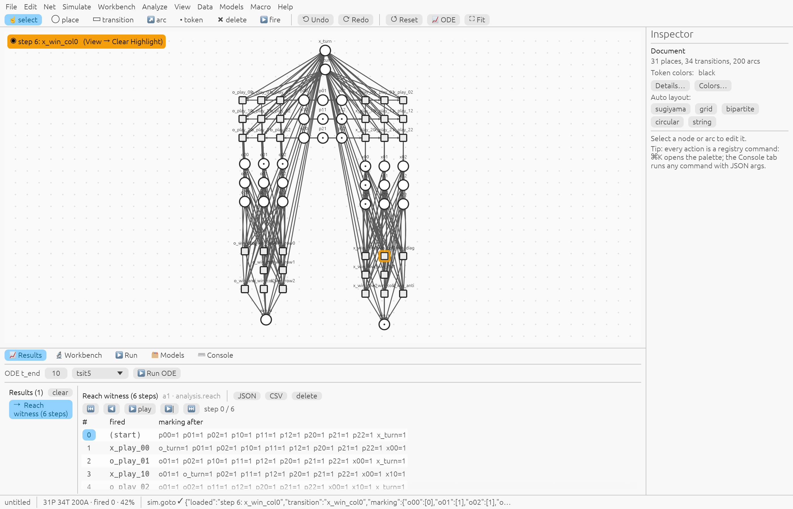
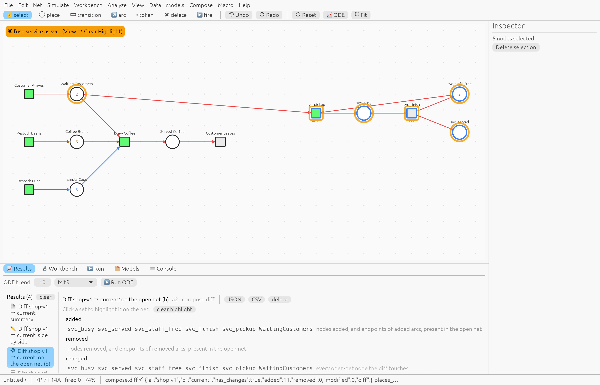
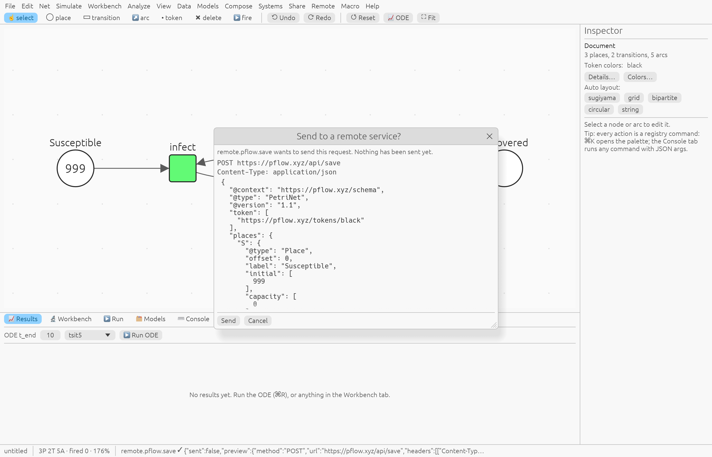
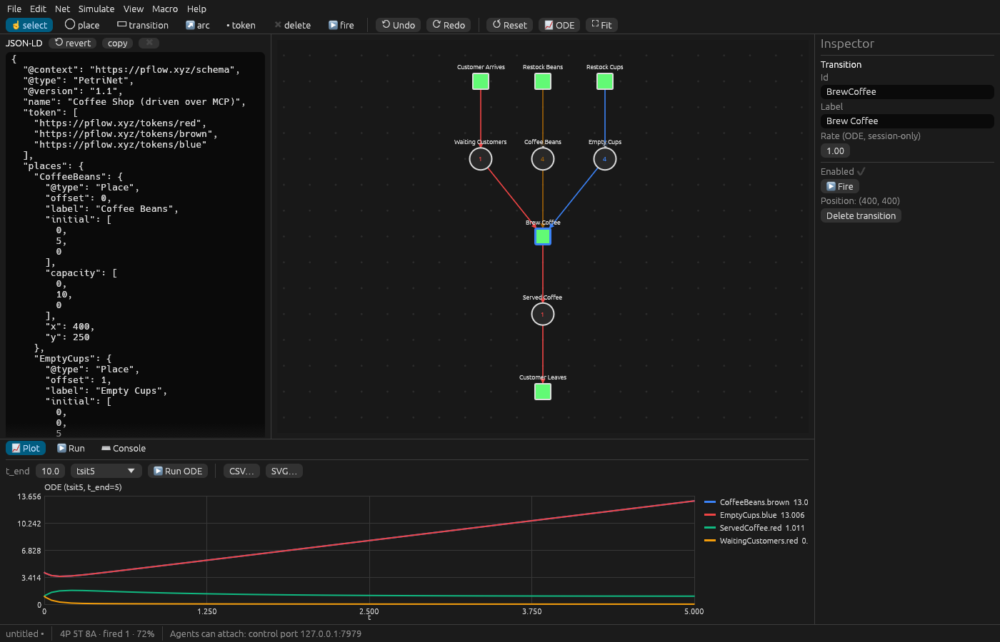
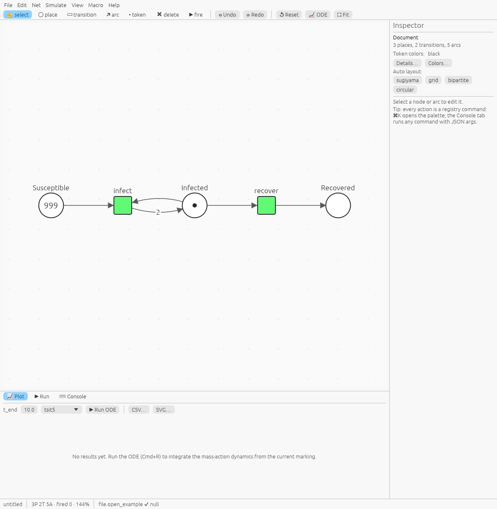

# pflow-native

A native Petri-net editor and simulator built on [pflow-rs](https://github.com/pflow-xyz/pflow-rs), using egui/eframe.

- It opens and saves the [pflow.xyz](https://pflow.xyz) editor JSON-LD.
- It plays the token game through pflow-rs's firing rule and integrates the mass-action ODE with `pflow-solver`.
- Every action is a command in one registry, so the window, the CLI, a JSON-lines control channel and an MCP server all drive the same thing.



## Run

```bash
make run                                   # cargo run --release -p pflow-native
cargo run -p pflow-native -- examples/coffee-shop.json
cargo run -p pflow-native -- --example sir --cmd 'sim.ode {"t_end":15}' \
    --screenshot out.png --size 1400x900   # headless-ish capture, then exit
make test && make lint && make wasm-check
```

**Offline build.** `make build-offline` builds the app and CLI without the `services` feature (`--no-default-features`). That build never contacts pflow.xyz, sim.pflow.xyz or GitHub:
- Gone: the Remote and Share menus, Accounts, `remote.*`, `auth.*`, `remote.credentials`, `file.open_cid` and `file.permalink`.
- Still there: everything local (editing, simulation, analysis, the store, provenance), plus `file.open_url` for a URL you give it.

`make test-offline` runs the tests for that build.

## Using the editor

| Key | Tool / action |
|---|---|
| 1 select · 2 place · 3 transition · 4 arc · 5 token · 6 delete | tools, numbered as in pflow.xyz |
| 8 / X | play mode (click a green transition to fire it) |
| double-click a transition | fire it from select mode |
| right-click the target in arc mode | make the arc inhibitor/read |
| token tool click / right-click | +1 / −1 |
| shift-click, shift-drag | multi-select, box select |
| drag empty space, middle-drag, space+drag, wheel | pan |
| pinch, ⌘+wheel | zoom |
| ⌘Z / ⌘⇧Z · Delete · Esc · F · R · ⌘R | undo/redo · delete · cancel · fit · reset marking · run ODE |
| ⌘C ⌘X ⌘V ⌘D | copy · cut · paste · duplicate |
| ⌘K · ⌘J · ⌘I · ⌘B | command palette · JSON pane · inspector · bottom panel |

The canvas snaps nodes to the 10-unit grid used by pflow.xyz (View → Snap to Grid). Menus are generated from the registry. Any command that takes arguments opens a form built from its argument spec, and **⌘K** searches every command. The app autosaves the document and settings, and restores them on the next start (`--fresh` skips that). The panels are:
- **Inspector** (right) edits labels, tokens, capacity, arc weight, inhibitor and rate.
- **Plot** shows the ODE time series with hover readout, a legend toggle, and CSV/SVG export.
- **Run** lists the fireable transitions, the marking table and seeded random runs.
- **Console** shows the journal and has a command line for any command.



**Content IDs.** `file.cid` computes a document's pflow.xyz CID and `file.seal` stores it as `@id`. Both use URDNA2015 → CIDv1 and are byte-identical to pflow.xyz's Go sealer on its parity goldens. Opening and saving a file keeps its CID.

## Simulation workbench

Results land in the **Results** tab, one view per kind:
- time series with ± bands and overlays, plus phase-plot and Δ-table modes
- heatmaps
- Pareto scatters
- tables
- reports

Each result exports as JSON, CSV or SVG. The **Workbench** tab lists every simulation command. Its forms fill transition and place arguments from what you have selected.

| Command | What |
|---|---|
| `sim.ode` | mass-action ODE (pflow-solver); solver options, place filter, initial/final/Δ |
| `sim.equilibrium` | integrate to steady state |
| `sim.ssa`, `sim.sde` | Gillespie SSA / chemical Langevin, seeded, with mean ± sd over runs |
| `sim.scenario`, `sim.compare` | sim.pflow.xyz-style what-ifs: marking/rate/schedule overrides, metrics, contention; N scenarios on one seed |
| `sim.crosscheck` | SSA vs ODE vs conservation laws (P-invariants), with a verdict |
| `sim.evaluate` | rank the moves enabled for a player by rollouts (games such as tic-tac-toe) |
| `opt.rate_scan`, `opt.sweep` | pflow.xyz's Rate Scan and Sweep |
| `opt.heatmap` | two rates on a grid, showing one place's final value |
| `opt.optimize` | Monte-Carlo over rate ranges, with a Pareto front over objectives |




## Analysis and data

| Area | Commands |
|---|---|
| Structure | `analysis.incidence`, `analysis.invariants` (P/T, highlighted on the net), `analysis.siphons` (siphons/traps, Commoner, deadlock witnesses), `analysis.validate`, `analysis.canonical` / `analysis.classify` (symmetry orbits, identical to sim.pflow.xyz on the bundled examples) |
| State space | `analysis.reachability` (graph; click a state to load it), `analysis.verify` (counterexamples become traces you can step through), `analysis.reach` (shortest witness or invariant certificate), `analysis.diagnose` (tornado) |
| Event logs | `data.load_log` (CSV/JSONL), `data.generate` (seeded synthetic logs), `data.conformance` (fitness/precision/…, residual on the net), `data.replay` (first divergence + repair), `data.discover` (alpha/heuristic mining → new net) |
| Learning | `data.calibrate` (rates from a log), `opt.fit` (ODE rates to observed series), `opt.distill` (game scorer vs exact minimax). With `apply`, the learned rates are one undo step |
| Views | `view.string_diagram` (pflow.xyz's string diagram), `net.layout {algorithm: "string"}` |




## Composition and systems

| Area | Commands |
|---|---|
| Library | `model.save / list / get / open / import / delete`, the Models tab ("current" = the open net) |
| Composition | `compose.components` (sim's 7 components + pflow-compose templates), `compose.fuse` (attach ports onto your places), `compose.extend` (sim's edit ops as one undo step), `compose.diff` (change table, canvas highlight, side-by-side drawing) |
| Systems | `system.set_port`, `system.bind` (unit / conversion / delay checks), `system.create` / `system.show` (graph), `system.run` (pipeline in topological order; delayed loops solved to a fixed point by sweeps) |



## Store, sharing and provenance

| Area | Commands |
|---|---|
| Local store | `store.put / get / open / list / delete` (keyed by the pflow.xyz CID, under `<data_dir>/store`), `store.link / edges / neighbors / query` (sim's predicate registry and query language), collections, irrevocable licenses, `store.supersede` / migration offers, content-addressed maps, `store.graph` |
| pflow.xyz | `remote.pflow.save / list / delete`, `remote.pflow.share` (page, `/img/{cid}.svg`, badge), `remote.gist` |
| sim.pflow.xyz | `remote.sim.tools`, `remote.sim.call` and wrappers (`create_model`, `publish`, `publish_app`, `prompt`, `prove`, `check_witness`) over MCP |
| Provenance | `sim.receipt` / `provenance.verify_receipt` (Ed25519, sim's receipt format, verified by replay), `provenance.check_witness` (traces, invariant certificates, morphism maps), `zk.setup / prove_fire / prove_trace / verify` (Groth16 via pflow-zk-arkworks; opt-in: `make build-zk`, since the upstream circuit does not yet prove enabledness) |

**Nothing leaves the machine by accident.** Every remote write returns a preview of the exact request, with credentials redacted, unless it is called with `"send": true`. In the app, a preview opens a confirmation window, and only **Send** sends. Credentials come from environment variables or `<data_dir>/credentials.json`, never from documents or the journal; `remote.credentials` shows which are configured. They are:
- `PFLOW_XYZ_TOKEN`: a GitHub token with `read:user`.
- `GITHUB_TOKEN`: a GitHub token with the `gist` scope.
- `SIM_PFLOW_TOKEN`: a sim OAuth access token, valid for 24 h.

Each credential goes only to its own hosts, over HTTPS: `PFLOW_XYZ_TOKEN` to `pflow.xyz`; `GITHUB_TOKEN` to `api.github.com` and `pflow.xyz`; `SIM_PFLOW_TOKEN` to `sim.pflow.xyz`. A caller-supplied `server` or `endpoint` that is not one of them is refused before anything is built or sent.

**Signing in.** Rather than pasting tokens, sign in from **Remote → Accounts…**, with `pflow-native-cli login sim|pflow`, or with `auth.login {"service": …}`:
- **sim.pflow.xyz** opens your browser on sim's own sign-in page, which uses Google. Underneath, this is sim's OAuth server: pflow-native registers itself as a client, uses PKCE and a one-off `127.0.0.1` redirect, and stores the access token as `SIM_PFLOW_TOKEN`. That token lasts a day and is renewed automatically with the refresh token, which lasts 90 days.
- **pflow.xyz** uses a GitHub sign-in, since pflow.xyz checks its bearer against GitHub. This is GitHub's device flow with pflow.xyz's OAuth app: you enter the code shown at github.com/login/device. The token is stored as `GITHUB_TOKEN`, so Gists use it too. The app needs **Enable Device Flow** turned on in its GitHub settings; until then the sign-in says so. `PFLOW_NATIVE_GITHUB_CLIENT_ID` points it at another OAuth app.

Tokens are written to `credentials.json` (owner-only) and never returned by a command. `auth.status` (`pflow-native-cli accounts`) shows what you are signed in to, and `auth.logout` forgets a sign-in. An environment variable still takes precedence over a sign-in.

**Who can send.**
- **The app** asks you every time.
- **The control port** is open only to whoever holds the per-launch token, which the app writes to `<data_dir>/control.json` (owner-only). Sends that arrive there still wait for your **Send** in the app. Batches over the port may not contain sends.
- **`pflow-native-cli control` and headless `mcp`** run over stdio and are started by you. They are trusted: a `send: true` there sends without a dialog, still only to the allowlisted hosts.

**Datasets stay server-computed.** sim stores only results it computed itself. pflow-native can ask it to compute (scenario, dataset, calibrate, publish), but never uploads locally computed datasets; `remote.sim.call` refuses `sim_map_put`. Models are not datasets and can be published.



## Agents: CLI, control channel, MCP

```bash
pflow-native-cli list net.                          # commands + JSON Schemas
pflow-native-cli exec -i examples/sir.json sim.ode '{"t_end":10}'
pflow-native-cli batch -i in.json -o out.json steps.json   # one undo step, atomic
pflow-native-cli control                            # stdin/stdout JSON lines:
#   {"id":1,"command":"net.add_place","args":{"x":100,"y":100}}
#   {"id":1,"ok":true,"result":{"id":"p0"}}
pflow-native-cli mcp                                # MCP over stdio (attaches to a running app)
```

**Driving the live window.** The app listens on `127.0.0.1:7979` for the same JSON-lines protocol. `--control ADDR` moves it and `--no-control` turns it off.
- `pflow-native-cli mcp` attaches to that port when the app is running, so the agent and you share one window. Otherwise it runs a private headless session. Use `--headless` or `--attach ADDR` to force either.
- In attached mode the `screenshot` tool returns the window as a PNG.



The MCP server's tools are:
- `list_commands` lists commands, optionally filtered by prefix.
- `execute` runs one command.
- `batch` runs `[{command,args}]` as one undo step and rolls back on failure.
- `get_state` returns the whole state.
- `screenshot` returns the window as a PNG (attached mode only).

To register it with Claude Code:

```bash
claude mcp add pflow-native -- /path/to/pflow-native-cli mcp
```

## Design

- [`ARCHITECTURE.md`](ARCHITECTURE.md) covers the layers, the registry, artifacts and views.
- [`FEATURES.md`](FEATURES.md) is the parity matrix against pflow.xyz and sim.pflow.xyz, with the phase plan.
- The command-registry, macro and MCP patterns were borrowed from storytold's [vectorcraft](https://github.com/storytold/vectorcraft) and [photocraft](https://github.com/storytold/photocraft) (MIT/Apache-2.0). They were re-implemented here; no code was copied.

pflow-rs is pinned to a git revision. To build against a sibling checkout instead, copy `.cargo/config.toml.example` to `.cargo/config.toml`.

## Web

`make wasm-check` keeps the core and the app compiling for `wasm32-unknown-unknown`. To build or serve the browser version with Trunk (`cargo install trunk`; see `crates/app/index.html`):
- `make web-build` writes `crates/app/dist/`.
- `make web` serves it.

On the web the autosave goes to browser storage, and `?data=` permalinks open. File dialogs, URL fetches and screenshots are native-only for now.



## License

MIT
